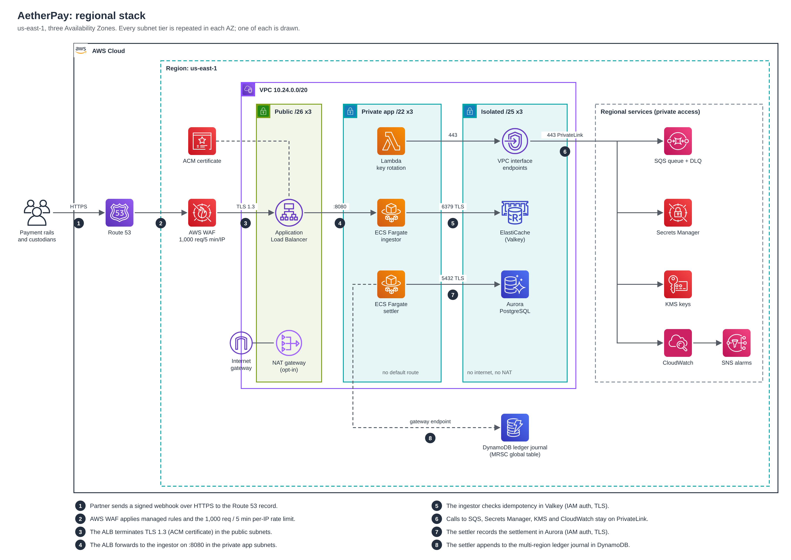
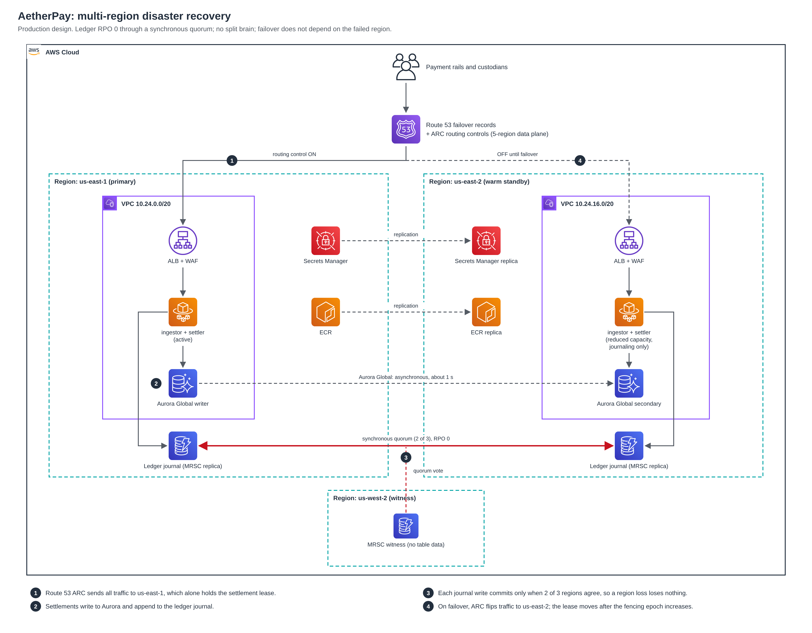
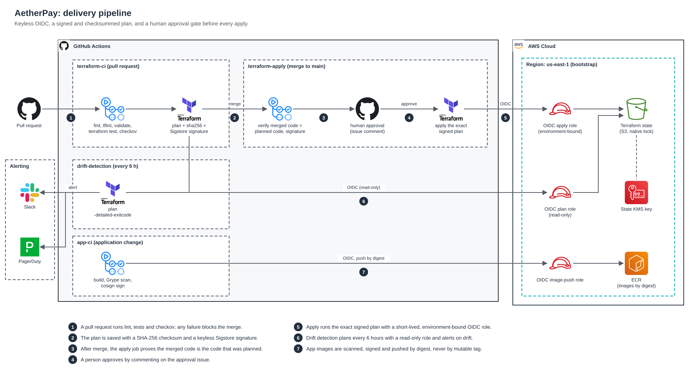

# AetherPay Infrastructure

Production-grade AWS infrastructure for **AetherPay**: a webhook ingestion and settlement platform for payment rails and vault custodians. It is built with Terraform and is multi-AZ, multi-region, zero-trust and fully codified.

| Deliverable | Location |
|---|---|
| Part 1: IaC (modules + environments) | [`terraform/`](terraform/) |
| Part 2: Broken-baseline audit and state migration | [`docs/VULNERABILITY-AUDIT.md`](docs/VULNERABILITY-AUDIT.md) |
| Part 3: DR architecture decision record | [`docs/ADR-001-Disaster-Recovery.md`](docs/ADR-001-Disaster-Recovery.md) |
| Part 4: CI/CD and drift detection | [`.github/workflows/`](.github/workflows/) |
| Reference workload (ingestor + settler) | [`app/`](app/) |

---

## Architecture

### Regional stack



### Multi-region (production)



The quorum, fencing and failover design (RPO 0 for the ledger, no split brain, no dependence on the failing region's control plane) is explained in [ADR-001](docs/ADR-001-Disaster-Recovery.md).

### Delivery pipeline



---

## Deployment evidence

Staging was deployed end to end to a real AWS account, tested, and destroyed the same day. Screenshots of every stage, including the failures found and fixed along the way, are in [`docs/evidence/`](docs/evidence/README.md).

---

## CIDR allocation

One `/20` (4,096 addresses) across three AZs and three tiers with no overlaps. The subnets are derived with `cidrsubnet()` in [`modules/networking/main.tf`](terraform/modules/networking/main.tf), checked by a `check` block at plan time, and asserted by [`tests/networking.tftest.hcl`](terraform/modules/networking/tests/networking.tftest.hcl).

| Tier | Prefix | AZ a | AZ b | AZ c | Usable / subnet | Routing |
|---|---|---|---|---|---|---|
| Public (ALB, NAT) | /26 | `10.24.0.0/26` | `10.24.0.64/26` | `10.24.0.128/26` | 59 | `0.0.0.0/0 -> IGW` |
| Isolated (data, endpoints) | /25 | `10.24.1.0/25` | `10.24.1.128/25` | `10.24.2.0/25` | 123 | local only |
| Private app (Fargate, Lambda) | /22 | `10.24.4.0/22` | `10.24.8.0/22` | `10.24.12.0/22` | 1,019 | local + S3/DynamoDB gateway endpoints; **no default route** |
| Spare | | `10.24.0.192/26`, `10.24.2.128/25` | `10.24.3.0/24` (reserved for TGW / growth) | | | |

The production secondary region uses `10.24.16.0/20` with the same layout, so the two VPCs never overlap if they are later peered.

**Isolation, enforced in three layers**

1. **Routing.** The app tier has no `0.0.0.0/0` route at all, so it cannot reach the internet even if a security group were opened. The isolated tier has only the local route.
2. **Security groups.** All in [`security_groups.tf`](terraform/modules/networking/security_groups.tf): `ALB -> app:8080 -> db:5432 / cache:6379 / endpoints:443`, and nothing has a `0.0.0.0/0` egress rule.
3. **NACLs.** The isolated tier accepts only `5432`, `6379` and `443` from the app CIDRs.

---

## How each requirement is met

| Requirement | Implementation |
|---|---|
| Single /20 over 3 AZs, three non-overlapping tiers | `modules/networking` (table above), validated input, `check` block and tests |
| App tier egress only to the isolated tier and AWS APIs | No default route; SG egress to the data SGs, the endpoint SG and the S3/DynamoDB prefix lists only; NAT is opt-in with allow-listed CIDRs, and `0.0.0.0/0` is rejected by validation |
| Isolated tier: zero egress, zero NAT, app-only on strict ports, PrivateLink | Local-only route table; NACL and SG allow just 5432/6379/443 from the app tier; interface endpoints live in this tier |
| ALB, TLS 1.3, WAF, 1,000 req / 5 min / IP | `modules/edge` (`ELBSecurityPolicy-TLS13-1-3-2021-06`, no port-80 listener, `drop_invalid_header_fields`, `desync_mitigation_mode = strictest`); `modules/security/waf.tf` (rate-based rule with `evaluation_window_sec = 300` and `limit = 1000`, IP reputation, known-bad-inputs, core rule set, redacted logging) |
| No public IPs; private service-to-service | `assign_public_ip = false`, `map_public_ip_on_launch = false`; services talk over private subnets |
| Containerised compute | ECS Fargate (`modules/compute`, `modules/ecs-service`): read-only root filesystem, non-root user, all capabilities dropped, digest-pinned images |
| Autoscaling on CPU/memory AND queue depth, asymmetric stabilisation | `modules/ecs-service/autoscaling.tf`: CPU, memory and ALB request target tracking; **SQS backlog-per-task** (metric math `visible / running tasks`) plus a step burst policy on oldest-message age. Scale-out cooldown 30-60 s, scale-in 600-900 s. The DLQ alarms but never scales. |
| Remote state, encryption, native locking | `terraform/bootstrap`: S3 + SSE-KMS (CMK, bucket key), versioning, TLS-only and wrong-key-denying bucket policy, `use_lockfile = true` (S3 native locking, no DynamoDB) |
| Secrets in Secrets Manager with CMK and automated rotation; none in code, state or env | `modules/secrets`: CMK-encrypted secrets with a 30-day rotation Lambda. **No secret version is ever written by Terraform**, so values never touch state. Aurora uses `manage_master_user_password` (RDS-rotated, CMK). Workloads use **IAM auth** for Aurora and Valkey, so no app passwords exist. Env vars carry ARNs only, and `ecs-service` rejects secret-looking variable names at plan time. |
| Least-privilege roles bound to workload identities | `modules/workload-iam`: one task role per service (the ECS equivalent of IRSA/Pod Identity) with a confused-deputy-safe trust policy; execution roles separate; permissions boundary on every role |
| No wildcards on storage/KMS/secrets; condition keys tying access to the VPC endpoint or workload | Exact ARNs everywhere; `aws:SourceVpce` on every Secrets Manager, SQS and DynamoDB statement; `kms:ViaService` + `kms:EncryptionContext:SecretARN` on KMS; `dynamodb:LeadingKeys` limits updates to fence and batch items; secret resource policies deny reads outside the endpoint or without the `aetherpay:workload` principal tag. Asserted by [`tests/iam.tftest.hcl`](terraform/modules/workload-iam/tests/iam.tftest.hcl). |
| Keyless CI | GitHub OIDC; plan roles trust `pull_request` / `main`; apply roles trust only `environment:<env>` |
| Static analysis that blocks | `terraform fmt`, `validate`, `terraform test`, `tflint` (AWS ruleset), `checkov` (`soft_fail: false`, SARIF report kept as a build artifact) |
| Immutable plan artifact | Plan on PR, PR comment, `tfplan` + SHA-256 + Sigstore keyless signature, 5-day retention; apply verifies all three plus "merged code == planned code", then runs `terraform apply tfplan` |
| Concurrency and state protection | `terraform-state-<env>` concurrency group shared by apply and drift (queue, never cancel), plus the S3 lock file with `-lock-timeout` |
| Scheduled drift detection | `drift-detection.yml`: `-detailed-exitcode` with 0/1/2 handled separately; Slack Block Kit and PagerDuty Events v2 alerts |

---

## Repository layout

```
terraform/
  bootstrap/              state bucket + CMK, GitHub OIDC roles, permissions boundary, ECR
  modules/
    networking/           VPC, subnets, routes, NACLs, SGs, VPC endpoints, flow logs (+ tests)
    security/             KMS CMKs (secrets, data, logs), WAF web ACL
    secrets/              signing-key secrets, resource policies, rotation Lambda
    messaging/            SQS ingestion queue + DLQ
    data/                 Aurora PostgreSQL (Serverless v2), ElastiCache Valkey
    ledger/               DynamoDB MRSC global table + multi-region CMK
    workload-iam/         per-service task roles (+ policy tests)
    compute/              ECS cluster (+ optional ECR)
    ecs-service/          hardened Fargate service + autoscaling
    edge/                 ACM, ALB, WAF association, access-log bucket, DNS
    dr-routing/           Route 53 ARC cluster, routing controls, failover records
    stack/                regional composition of the modules above
  environments/
    staging/              one region + ledger (+ mocked end-to-end plan test)
    production/           us-east-1 primary, us-east-2 standby, ARC (+ test)
app/                      Python ingestor (FastAPI) and settler, Dockerfile, tests
docs/                     ADR-001, vulnerability audit
.github/workflows/        terraform-ci, terraform-apply, drift-detection, app-ci
scripts/                  drift-alert.sh (Slack / PagerDuty), configure-github.sh (CI setup)
```

---

## Local validation (no AWS account needed)

Requirements: Terraform >= 1.10 (CI uses 1.17.1), TFLint 0.59+, Checkov 3.x, Python 3.12. The [dev container](.devcontainer/devcontainer.json) has everything, so the repo also opens in GitHub Codespaces.

```bash
make check        # everything below in one go

make lint         # terraform fmt -check, tflint (AWS ruleset)
make validate     # terraform validate for bootstrap, staging, production
make test         # terraform test: CIDR plan, IAM policy rules, full mocked plans of both environments
make security     # checkov (0 failed; exceptions are justified inline)
make app          # ruff + pytest for the ingestor and settler
```

Current results: 12 Terraform tests pass, `validate` is clean, `tflint` reports nothing, Checkov reports 2,108 passed and 0 failed, and 23 app tests pass.

---

## Deploying

### 1. Bootstrap (once per AWS account, from a terminal with admin credentials)

```bash
cd terraform/bootstrap
terraform init
terraform apply                      # creates state bucket, CMK, OIDC roles, boundary, ECR
terraform output                     # values for the next steps
```

Then move the bootstrap state into the bucket it created: copy the commented `backend "s3"` block from `bootstrap/versions.tf` into a local `backend_override.tf` (git-ignored, so account IDs stay out of the repo), fill in the bucket name and `kms_key_id` (the bucket policy rejects writes that do not name the state key), and run `terraform init -migrate-state`. If your account already has the GitHub OIDC provider, add `-var create_github_oidc_provider=false` to the apply.

### 2. Configure GitHub

The quickest route is the helper script, which reads the bootstrap outputs and sets every variable below with the GitHub CLI:

```bash
scripts/configure-github.sh ISMAIL-OYELEKE/aetherpay-infra webhooks.staging.<your-domain> <route53-zone-id> oncall@<your-domain>
```

Or set them by hand. **Repository variables** (Settings, Secrets and variables, Actions, Variables):

| Variable | Value |
|---|---|
| `AWS_REGION` | `us-east-1` |
| `TF_STATE_BUCKET` | `terraform output -raw state_bucket` |
| `TF_STATE_KMS_KEY_ARN` | `terraform output -raw state_kms_key_arn` |
| `ECR_REPOSITORY_URL` | `terraform output -raw ecr_repository_url` |
| `AWS_IMAGE_PUSH_ROLE_ARN` | `terraform output -raw image_push_role_arn` |
| `AWS_PLAN_ROLE_ARN_STAGING` / `_PRODUCTION` | from `plan_role_arns` |
| `AWS_APPLY_ROLE_ARN_STAGING` / `_PRODUCTION` | from `apply_role_arns` |
| `TFVARS_STAGING` / `TFVARS_PRODUCTION` | account-specific HCL, see below |
| `TF_ENVIRONMENTS` | optional; environments CI plans, applies and drift-checks. Defaults to `["staging"]`; set `["staging","production"]` once production is configured |

```hcl
# TFVARS_STAGING
ecr_repository_arn       = "arn:aws:ecr:us-east-1:<account>:repository/aetherpay/app"
permissions_boundary_arn = "arn:aws:iam::<account>:policy/aetherpay-workload-boundary"
key_admin_arns           = ["arn:aws:iam::<account>:role/aetherpay-gha-apply-staging"]
domain_name              = "webhooks.staging.<your-domain>"
hosted_zone_id           = "<route53 zone id>"
alarm_emails             = ["oncall@<your-domain>"]
```

**Secrets:** `SLACK_WEBHOOK_URL` and `PAGERDUTY_ROUTING_KEY` (drift alerts).

**Environments:** create `staging` and `production`. The apply job always waits for a human: it opens an issue with the plan summary and continues only after an approver (`APPLY_APPROVERS` variable, default the repo owner) comments `approve`. On a GitHub plan that supports it, also add Environment required reviewers and protect `main`.

**Branch protection on `main`:** require PRs, the `terraform-ci` and `app-ci` checks, and "branches up to date before merging" (this keeps the planned code identical to the merged code). Branch protection on a private repository needs GitHub Pro or Team; on the free plan, the apply job's checksum and signature checks still guarantee that what is applied is exactly what was planned.

### 3. Ship the first image and deploy staging

1. Run the `app-ci` workflow on `main` (Actions, app-ci, Run workflow). The job summary prints `…/aetherpay/app@sha256:…`.
2. Open a PR that sets `app_image` in [`terraform/environments/staging/image.auto.tfvars`](terraform/environments/staging/image.auto.tfvars).
3. Review the plan comment and merge. The apply workflow verifies the signed plan, opens an "Apply to staging" issue, and applies only after you comment `approve` on it.

To work locally instead: `cp backend.hcl.example backend.hcl`, fill it in, run `terraform init -backend-config=backend.hcl`, then `terraform plan -out=tfplan` and `terraform apply tfplan`.

### Cost and teardown (staging)

Staging is sized small (1 Aurora Serverless v2 instance at 0.5-2 ACU, 2 x `cache.t4g.micro`, 3 Fargate tasks, 9 interface endpoints x 3 AZs, ALB, WAF) and has deletion protection off. Expect roughly USD 10-20 per running day. The required inputs (ECR repository, permissions boundary and so on) live in the `TFVARS_STAGING` repository variable, which CI writes to `ci.auto.tfvars`, so a local destroy needs them too. After `terraform init` against the remote state, tear down with:

```bash
gh variable get TFVARS_STAGING > /tmp/staging.tfvars
terraform -chdir=terraform/environments/staging destroy -var-file=/tmp/staging.tfvars
rm /tmp/staging.tfvars
```

Production adds a second region, an ARC cluster and larger capacity; do not deploy it to a personal account.

---

## Security notes and accepted trade-offs

- **ALB to target is HTTP inside the VPC.** TLS 1.3 terminates at the ALB as specified; the hop runs only between SG-locked private subnets. End-to-end TLS can be added with a sidecar if required.
- **ALB access-log bucket uses SSE-S3**, because ELB log delivery does not support SSE-KMS.
- **The deploy role uses `PowerUserAccess` plus scoped IAM.** It can only create roles that carry the workload permissions boundary, and it cannot modify CI roles or the boundary itself.
- **Endpoint policies** list explicit API actions and restrict callers to this account (`aws:PrincipalAccount`); identity policies scope the resources.
- **Checkov exceptions** are annotated inline with `#checkov:skip=<id>:<reason>`; global skips (cross-module false positives) are listed and explained in [`.checkov.yaml`](.checkov.yaml).
- **Third-party actions** are pinned to major versions for readability; pin them to commit SHAs (for example with Dependabot or `pinact`) before production use.
